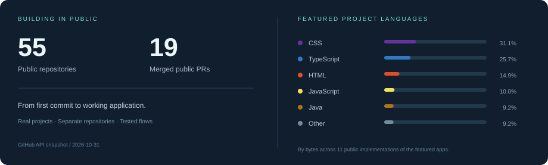

<b>Interfaces, APIs and everything in between.</b> Angular · React · Spring Boot · ASP.NET Core · Express

<table>
<tr>
<td width="55%" valign="middle">
<h3>A little about me 👋</h3>

I build practical web applications with clear interfaces and reliable APIs.

</td>
<td width="45%" valign="middle"></td>
</tr>
</table>

🛠️ <b>Building:</b> workflow tools, payment tracking, webhook delivery and team scheduling.

🧩 <b>My approach:</b> layered architecture, consistent data and complete user flows.

🌱 <b>Exploring:</b> different ways to solve the same product problem across JavaScript, Java and C#.

<a href="#selected-work">Explore my projects ↓</a> · <a href="https://github.com/hassanbera?tab=repositories">All repositories ↗</a>

<h2 align="center">Languages &amp; Tools</h2>

<b>Frontend</b>

 &nbsp;  &nbsp;  &nbsp;  &nbsp;  &nbsp; 

<b>Backend</b>

 &nbsp;  &nbsp;  &nbsp;  &nbsp;  &nbsp; 

<b>Data &amp; Development</b>

 &nbsp;  &nbsp;  &nbsp; 

<h2 align="center">Selected Work</h2>

Four products. Three stacks. Each implementation lives in its own repository.

<table>
<tr>
<td width="50%" valign="top">

<h3>TaskBoard</h3>

A focused Kanban workspace with boards, custom stages, drag-and-drop cards and task filters.

<a href="https://github.com/hassanbera/taskboard-spring">Angular + Spring Boot</a> · <a href="https://github.com/hassanbera/taskboard-dotnet">Angular + .NET</a> · <a href="https://github.com/hassanbera/taskboard">React + Express</a>

</td>
<td width="50%" valign="top">

<h3>PayTrack</h3>

Payment plans, monthly installments and partial collections with precise amounts and idempotent payments.

<a href="https://github.com/hassanbera/paytrack-spring">Angular + Spring Boot</a> · <a href="https://github.com/hassanbera/paytrack-dotnet">Angular + .NET</a> · <a href="https://github.com/hassanbera/paytrack">React + Express</a>

</td>
</tr>
<tr>
<td width="50%" valign="top">

<h3>HookWatch</h3>

A durable webhook queue with signed HTTP delivery, automatic retries and a persistent attempt history.

<a href="https://github.com/hassanbera/hookwatch-spring">Angular + Spring Boot</a> · <a href="https://github.com/hassanbera/hookwatch-dotnet">Angular + .NET</a> · <a href="https://github.com/hassanbera/hookwatch">React + Express</a>

</td>
<td width="50%" valign="top">

<h3>SlotBook</h3>

A weekly team calendar with employee filters, race-safe scheduling and appointment lifecycle tracking.

<a href="https://github.com/hassanbera/slotbook-spring">Angular + Spring Boot</a> · <a href="https://github.com/hassanbera/slotbook-dotnet">Angular + .NET</a>

</td>
</tr>
</table>

<b>How these projects are built</b>

| Interface | API | Data layer |
| --- | --- | --- |
| Angular + TypeScript | Java + Spring Boot | JPA + Flyway + PostgreSQL |
| Angular + TypeScript | C# + ASP.NET Core | EF Core + PostgreSQL |
| React + TypeScript | Express + TypeScript | Prisma + PostgreSQL |

Each repository includes setup instructions, database migrations, application previews and HTTP integration tests. The backend follows model → repository → service → controller responsibilities.

<h2 align="center">GitHub at a Glance</h2>

Public repositories only · A dated snapshot of real GitHub data, not a live counter.

---

<b>Let's build something useful.</b> Clear interfaces. Reliable APIs. Consistent data.

